# dsh-svn-viewer

> A read-only SVN viewer for DeepSeek Harness.

DeepSeek Harness 的 SVN 只读文件查看器：连上本地工作副本或仓库地址，就能浏览目录、搜文件、看内容、翻历史、查逐行归属和差异，全程不用离开面板。

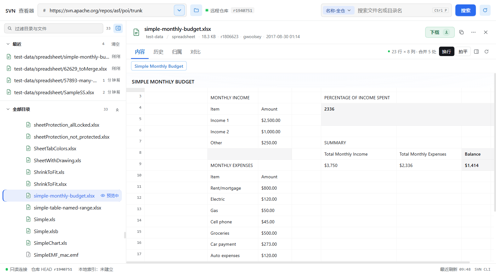

## 特性

- **连接即浏览**：本地工作副本路径或 `svn://` / `http(s)://` / `file://` 地址；目录树懒加载，点整行展开并切到该目录的文件列表。
- **多格式预览**：文本/代码（行号）、Markdown、图片、PDF，Word/Excel/PPT 按版式渲染（Excel 还原合并单元格与双层表头）。
- **全仓文件名搜索**：远程仓库首次建一份本机索引，之后每次几秒出结果；全文搜索覆盖本地工作副本（含 Office 正文）。
- **历史 · 归属 · 对比**：任意文件/目录的提交记录、逐行作者归属、分级着色差异，点修订号即看该版本。
- **最近 + 可收起侧栏**：侧栏记住最近打开的文件；目录栏可收起成 44px 图标条，悬停出浮层。
- **导出与下载**：单文件直接下载，目录打包 zip（带进度、可取消）。
- **只读、双主题**：没有提交/更新/删除入口；跟随宿主明暗主题。
- **键盘友好**：方向键漫游目录树，Ctrl+P 聚焦搜索，Esc 逐层关闭。

## 截图一览

| | |
|:---:|:---:|
| 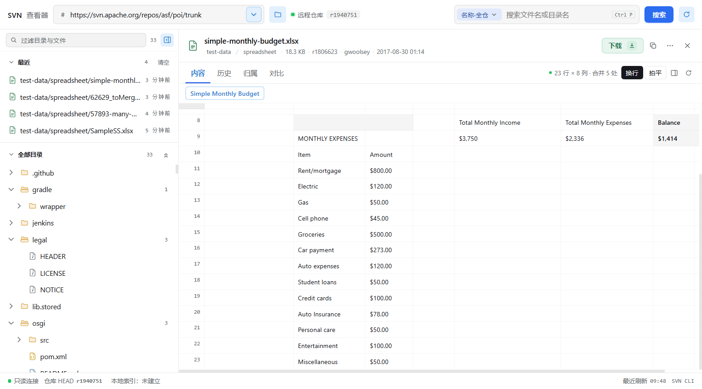 最近 + 全部目录两段 | 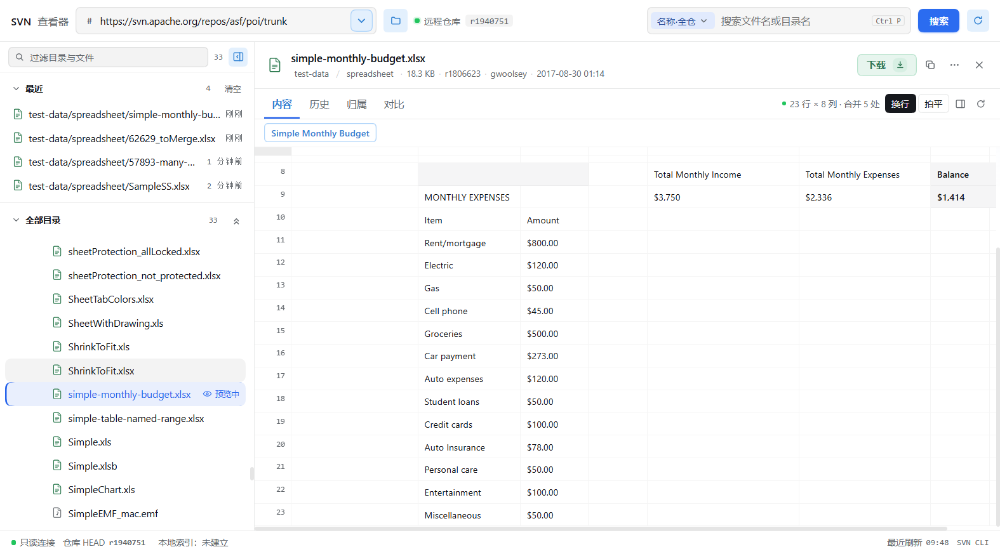 Excel 版式预览 |
| 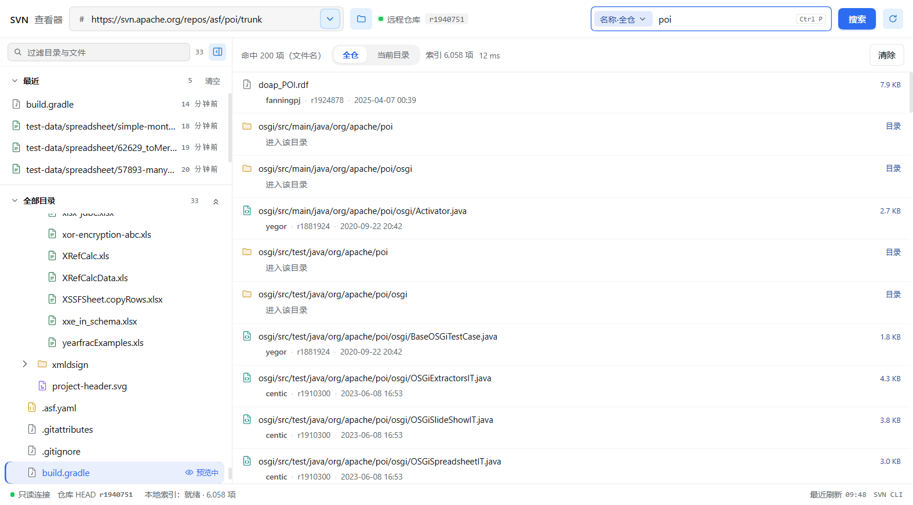 全仓搜索 | 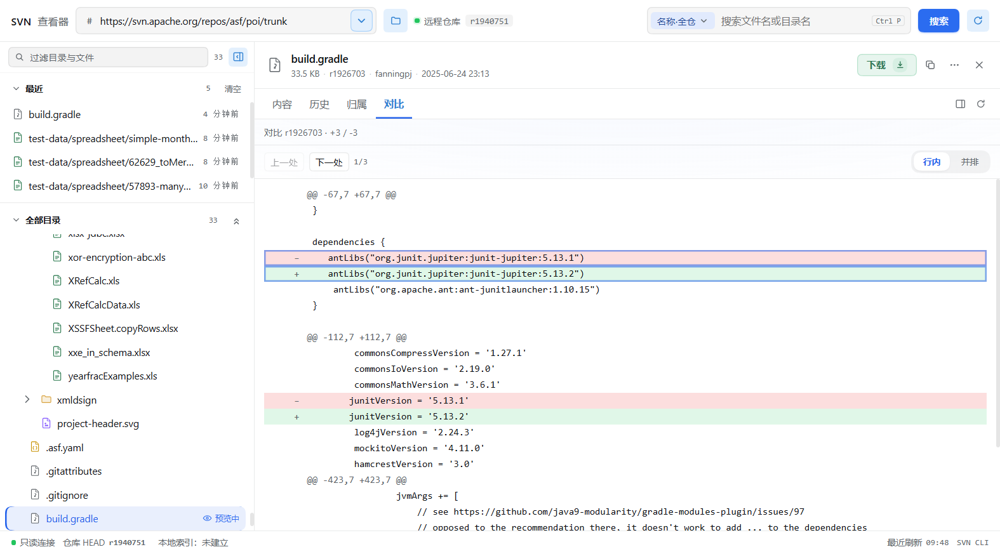 差异对比 |
| 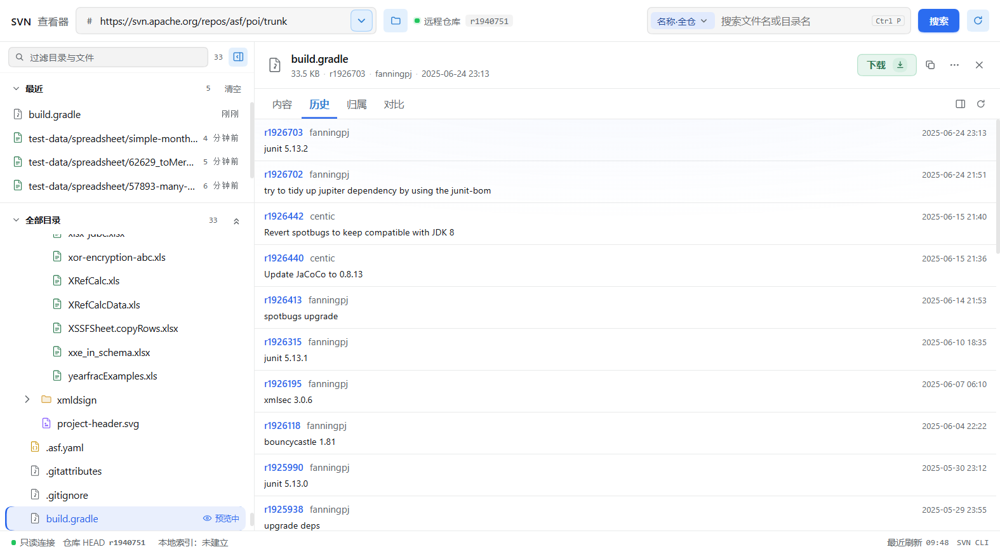 提交历史 | 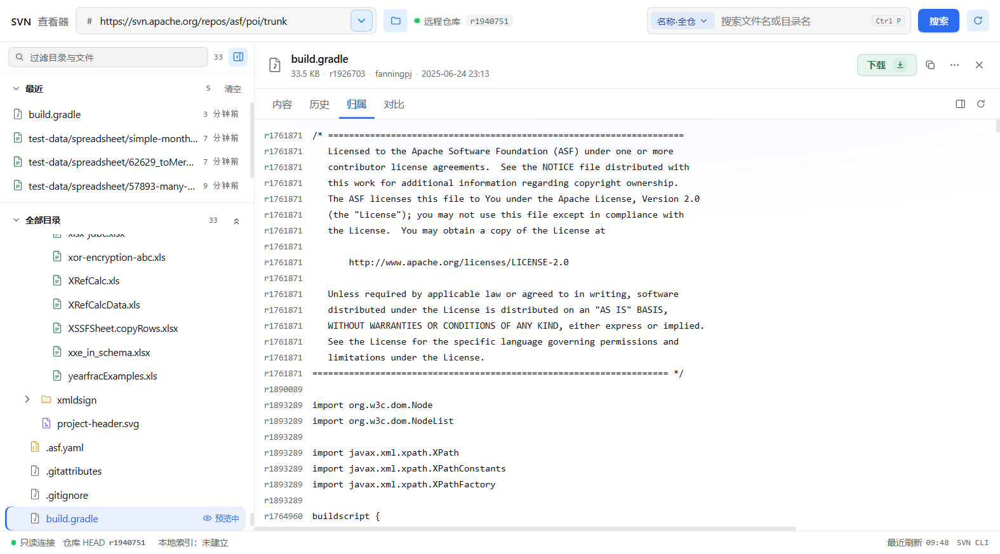 逐行归属 |
| 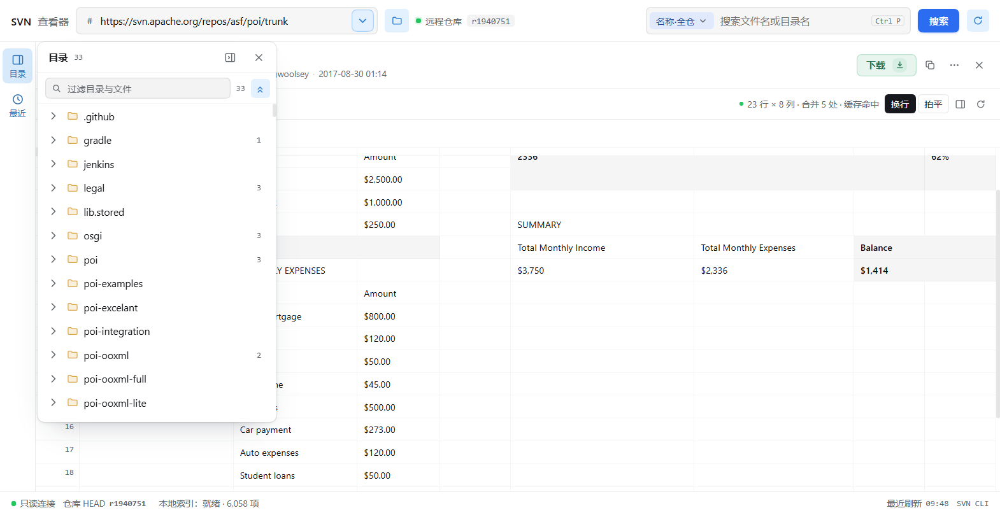 收起态 + 浮层树 | 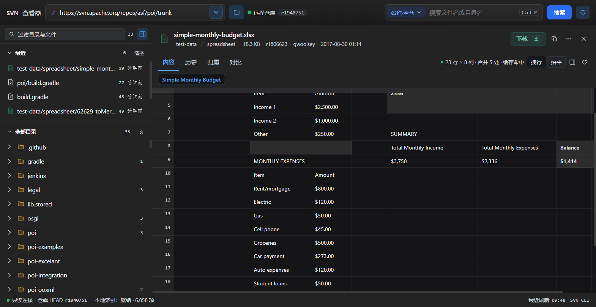 深色主题 |

## 安装

1. 添加插件：在 DSH 的 Plugins 页添加本地目录 `dsh-svn-viewer`（或让 agent 用 `plugin_manager` 的 `install_bundle` 安装 `dist/` 下的 tgz）。
2. 刷新页面。
3. 左栏出现「SVN」入口，点开即为主面板。首次打开会尝试连接 `lib/client.js` 顶部的 `DEFAULT_ROOT`（默认公开示例仓库 `https://svn.apache.org/repos/asf/poi/trunk`），失败则显示输入框与发现的工作副本。

## 快速开始

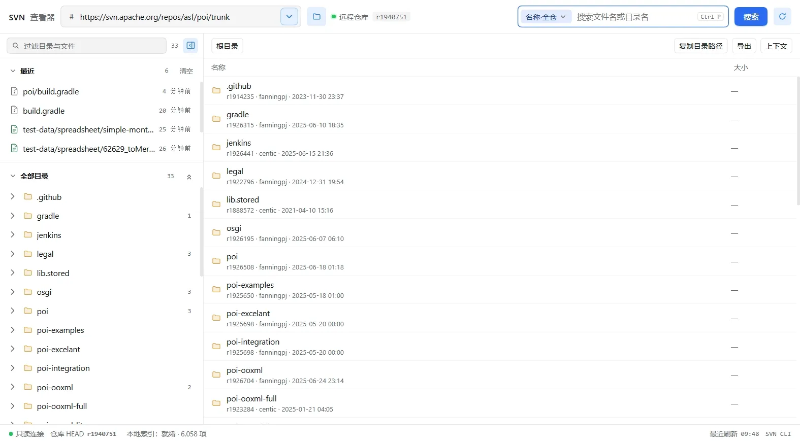

- 地址栏粘贴工作副本路径或仓库 URL，回车连接；也可以点地址栏右侧的文件夹按钮，先选盘符再逐层进入，选中后直接连接。
- 左栏点目录展开、点文件预览；树顶过滤框只过滤已加载节点，不发请求。
- 文件头显示路径·体积·修订·作者·日期，右侧是下载等动作；Esc 关闭预览。

## 搜索

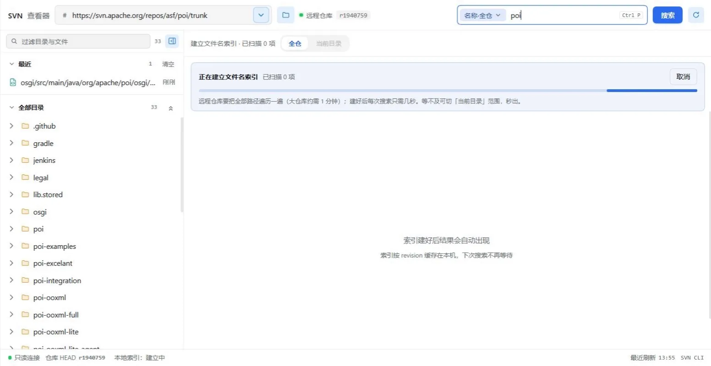

两种模式：

- **文件名**（默认搜整个仓库，可切当前目录）：远程仓库第一次搜索会在本机建一份全仓索引——大仓库约 1 分钟（视仓库规模），期间有进度卡、可随时取消；建好后每次几秒出结果。索引按仓库最新修订失效，7 天没用会重建。
- **全文**：需要本地工作副本，覆盖文本文件与 docx/xlsx/pptx 正文；远程仓库只能按文件名搜。

## 历史 · 归属 · 对比

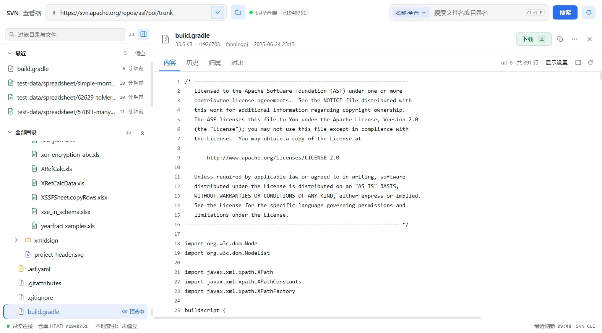

- 历史：任意文件或目录的提交记录，点任意修订按该版本查看。
- 归属：文本文件逐行给出修订与作者，点修订号跳到该版本。
- 对比：分级着色，支持行内/并排与上一处/下一处跳转；不带修订时对比工作副本与 BASE。

## 侧栏收起与浮层

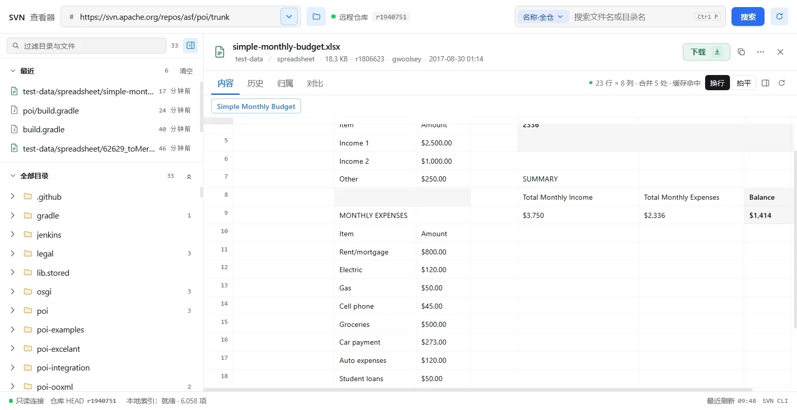

- 树顶「收起目录栏」按钮把侧栏收成 44px 图标条（目录 / 最近）。
- 悬停图标出浮层，悬停期间持续显示；点击图标展开侧栏；Esc 只关浮层，不关预览。

## 键盘快捷键

| 按键 | 作用域 | 动作 |
| --- | --- | --- |
| ↑ / ↓ | 目录树 | 在可见行间移动焦点 |
| → | 目录树 | 展开折叠的目录；已展开则移到下一行 |
| ← | 目录树 | 折叠已展开的目录；否则跳到父行 |
| Home / End | 目录树 | 第一个 / 最后一个可见行 |
| Enter / Space | 目录树 | 目录→打开目录列表；文件→打开预览 |
| ↑ / ↓ / Enter | 搜索命中行 | 移行 / 打开命中 |
| Enter / Space | 历史行、归属修订号 | 按该修订查看 |
| Ctrl+P（macOS ⌘P） | 全局 | 聚焦搜索框 |
| Enter | 地址栏 / 搜索框 | 连接 / 执行搜索 |
| Esc | 分层关闭 | 目录选择器、收起态浮层各自只关自己（浮层过滤框有字时先清过滤）；预览态先关内部浮层再关预览；树过滤框内清空过滤；搜索框内清空关键词与结果；地址栏内收起最近下拉 |

注：Ctrl+P 被用作搜索聚焦，会覆盖浏览器打印快捷键（已知取舍）。

## 设置与记忆

搜索模式与范围、树宽（220–560px，拖分隔条调整、双击复位）、目录栏收起态、两段折叠态、最近打开的文件（上限 12 条，可清空）、连接过的地址，都记在浏览器本机（localStorage），刷新后保持。最近只记打开过的文件，点一条直达预览。

## 限制与常见问题

| 项 | 说明 |
| --- | --- |
| 只读 | 不提供提交、更新、删除入口 |
| 需要 svn CLI | TortoiseSVN 命令行工具或 SlikSVN；凭据取自 `%APPDATA%\Subversion` |
| 全文搜索 | 仅本地工作副本（文本 ≤1MB、Office ≤8MB 且最多 200 个）；远程仓库只按文件名 |
| 首次索引 | 大仓库约 1 分钟，可取消；按修订失效，7 天未用重建 |
| 文本预览 | 超过 2MB 截断 |
| 导出上限 | 宿主打包 800 文件 / 120MB；浏览器端兜底 300 文件 / 60MB |
| 宿主改动 | `lib/index.js` 改动需重启 `dsh web`；客户端改动刷新页面即生效 |

## 更多文档

- [产品说明（中文）](docs/PRODUCT-zh-CN.md) · [Product (English)](docs/PRODUCT.md)
- [发版流水线](docs/RELEASE.md) · [变更记录](docs/CHANGELOG.md)
- [方案图绘制纪律](docs/ui-drawing-rules.md)

## 开发与自检

自检命令、测试矩阵与结构说明见 [docs/PRODUCT-zh-CN.md 的自检节](docs/PRODUCT-zh-CN.md)。